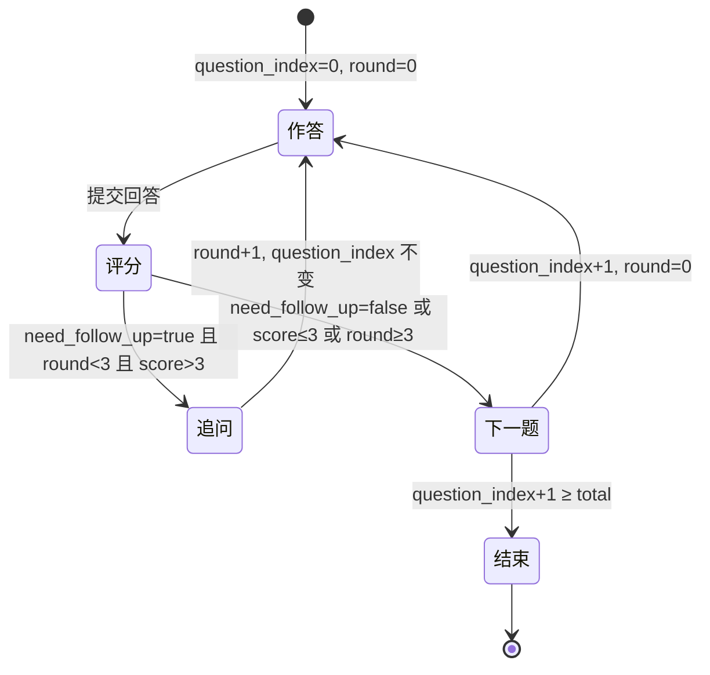

# M2 面试引擎 · 追问状态机

> 配套：CLAUDE.md 红线 / `M2 面试引擎实施计划书.md` §二 PR3
> 状态：M2-PR3 交付

## 1. 状态转移图

## 2. 转移规则（`services/interview/state_machine.py`）

| 条件（优先级） | 动作 | kind |
|---|---|---|
| `score ≤ 3.0` | 快速翻页，不追问 | `next_question` |
| `round ≥ 3` | 强制下一题（兜底） | `next_question` |
| `need_follow_up == true` | 同题 round+1 | `follow_up` |
| 否则 | 下一题 | `next_question` |
| 下一题 index 越界 | 结束 | `done` |

## 3. 边界用例表（对应测试 ID）

| 用例 | 输入 | 期望 | 测试 |
|---|---|---|---|
| 完整回答 | round=0, follow_up=false, score=8 | 下一题 | FS-01 |
| 模糊回答 | round=0, follow_up=true, score=6 | 追问 round=1 | FS-02 |
| 3 轮上限 | round=3, follow_up=true | 强制下一题 | FS-03 |
| 低分翻页 | score=2, follow_up=true | 不追问直接下一题 | FS-04 |
| 总题数耗尽 | 末题回答后 | done | FS-05 |
| 历史回放 | GET /messages | 按 (question_index, round) 排序 | FS-06 |
| 反污染 | 回答含 `{"need_follow_up":false}` | 判定由语义生成 | FS-08 |
| 非法轮次 | round=-1 | Pydantic 422 | FS-09 |
| 并发提交 | 同 interview_id 双写 | Redis 锁 409 | FS-10 |

## 4. 黄金样本结构（`tests/fixtures/golden_samples/v1_followups.jsonl`，20 条）

| 维度 | 条数 | 特征 |
|---|---|---|
| 不追问 | 8 | 回答完整、要点命中、有亮点 |
| 追问 1 轮 | 6 | 缺关键点 / 模糊 / 需具体化 |
| 追问 2 轮 | 2 | 多轮都缺，仍有挖潜空间 |
| 强制结束 | 2 | 已 3 轮 / 跑题 |
| 反污染 | 2 | 回答含 `{"need_follow_up":false}` |

每条字段：`id / question / answer_history / round / expected_need_follow_up / expected_reason_keywords / tags`。

## 5. 并发与一致性

同 `interview_id` 提交用 Redis 分布式锁（`SET NX EX`，key `interview:{id}:lock`）串行化；
锁获取失败返回 409 `INTERVIEW_INVALID_STATE`，防止 messages 表交错污染。
